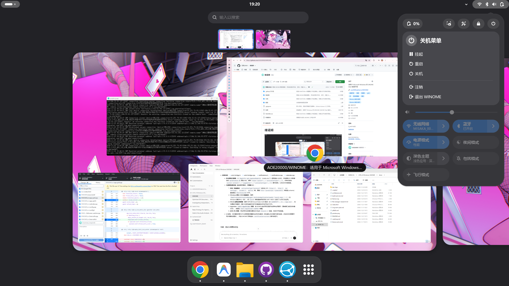

# WINOME




在 Microsoft Windows 上用 Windows 原生功能支撑的 GNOME Shell UI 复刻。

## 仓库结构

```
.
├── WINOME/          # 主工程（meson 构建根，C++ 宿主 + GTK4 UI + St 引擎）
├── docs/            # 项目开发文档（环境、架构、主题管线、踩坑记录与开发日志）
├── extracted/       # 从上游提取、经 WINOME 修改的参考模块（去掉了上游 git）
│   ├── GMONE-Shell/ # Shell 外观（Sass 主题 + SVG）+ 布局/日期/动画算法参考
│   └── WinOverview/ # 旧概览方案（DLL 注入，已退役，仅参考）
├── upstream/        # 上游完整仓库（独立 git，仅供参考/更新提取）
│   ├── gnome-shell/ # GNOME Shell（GPL-2.0-or-later）
│   ├── Seelen-UI/   # 启发实现（AGPL-3.0-or-later，仅致谢，不派生）
│   └── WinOverview/ # GNOME 概览复刻（GPL-2.0）
├── .github/         # GitHub Actions CI 工作流（UCRT64 测试、release 构建与打包）
├── WINOME/package.sh# 自包含便携版打包脚本（收集运行时 DLL、loaders、schemas 与图标）
├── build.sh         # 交互式构建程序（生产/测试/调试方案）
└── LICENSE / README.md
```

- **宿主进程**：`WINOME/src/`（C++17 + GTK4，单进程含配置、i18n、设置窗、系统托盘、`shell-ipc` 双向 Named Pipe、60s 会话结束确认弹窗、`window-theming` 可选 DWM 统一样式、`perf-metrics` 遥测/熔断、纯 Win32 崩溃恢复弹窗、`diagnostics-export` 一键排障压缩包导出、Looking Glass 控制台、`Alt+F2` 运行弹窗与 `plugin-host` 进程外插件宿主机）
- **非提权 CLI 控制端**：`WINOME/ctl/`（`winome-ctl.exe`，无 UAC 清单、无 GTK4 依赖，经 User-SID + Medium-IL Named Pipe DACL 与宿主实时交互）
- **概览（Activities）**：`WINOME/src/overview*.cpp`（含多屏同时展开 `overview-secondary.cpp`）+ `live-wallpaper.cpp` + `app-index.cpp` + `app-grid.cpp`（搜索、第三方动态壁纸引擎无边框 WGC 混合同步、开始菜单 `start2.bin` 解密编组与 `Programs` 目录单向同步分页应用网格、默认黑名单过滤、Dash Favorites、DWM 缩略图与四向跨屏跨工作区拖拽）
- **St CSS 引擎复刻**：`WINOME/st-compat/`（libcroco + st-theme-node，去 Clutter/Cogl）
- **隐藏/替换 Windows 原生界面**：`WINOME/src/`（`native-taskbar.cpp` + `win-event-hook.cpp`，独立实现，思路受 Seelen-UI 启发）
- **多屏工作区与虚拟桌面**：`WINOME/src/workspace-manager.cpp` + `virtual-desktop.cpp`（内置每显示器独立工作区引擎 / GNOME 仅主屏 / 全局同步三模式，底层移植并扩展 VirtualDesktopAccessor-rust COM 接口，覆盖 Win11 22621 / 24H2+）
- **系统集成与通知**：`WINOME/src/winrt-bridge.cpp`、`notifications.cpp`、`systray.cpp`、`monitor-manager.cpp`
- **示例插件与外观参考**：`WINOME/examples/plugins/sysmon-sample/`、`extracted/GMONE-Shell/`

## 构建（MSYS2 UCRT64）

推荐使用根目录的交互式构建程序（环境配置与已知构建问题见 [docs/build-and-env.md](docs/build-and-env.md)）：

```bash
./build.sh          # 交互式菜单
./build.sh release  # 或直接指定方案
```

| 方案 | 配置 | 构建目录 | 说明 |
|------|------|----------|------|
| `release` 生产 | release + LTO + NDEBUG | `WINOME/build-release/` | 最小体积、最快指令（约 2.7–2.9MB） |
| `test` 测试 | debugoptimized | `WINOME/build/` | 项目默认，保留 `g_print` 诊断日志 |
| `debug` 调试 | debug（-O0 -g） | `WINOME/build-debug/` | GDB 友好 |

其他子命令：`./build.sh run`（运行最近构建）、`./build.sh clean`（清理全部构建目录）。三方案独立目录，切换互不触发重编。

### 测试、样式检查与便携打包

```bash
# 运行单元测试与 CSS 转换测试
meson test -C WINOME/build --print-errorlogs

# 检查 St → GTK4 属性覆盖与 C++ 源码样式类覆盖率
python3 WINOME/tools/check-st-css-coverage.py WINOME/build/src/theme/gnome-shell-dark.css WINOME/build/src/theme/gnome-shell-gtk4.css
python3 WINOME/tools/check-widget-classes.py WINOME/build/src/theme/gnome-shell-gtk4.css WINOME/src/*.cpp

# 生成自包含便携目录与 zip 安装包（默认先执行 ./build.sh release，可传 --no-build 复用）
./WINOME/package.sh
```

也可手动构建（等价于测试方案，注意先设置 ASCII 临时目录，详见 [docs/build-and-env.md](docs/build-and-env.md)）：

```bash
cd WINOME
meson setup build
ninja -C build
./build/src/winome.exe
```

## 当前状态

- [x] 宿主进程骨架 + 置顶全宽顶栏（Activities 圆点 + 时钟 + 状态区图标 + 悬停/点击动画）
- [x] **崩溃自愈、任务栏兜底恢复与一键排障导出**：独立 `--watchdog` 看门狗、`--restore` 急救、`--safe-mode` 安全模式、`force_restore_all()` + `ABM_GETSTATE` 状态还原、`MiniDumpWriteDump` 转储、无 GTK4 依赖纯 Win32 崩溃恢复弹窗（`crash-dialog.cpp`，提供立即还原任务栏 / 安全重启 / 常规重启 / **一键导出排障压缩包** / 打开数据目录），并在设置页与崩溃弹窗内置 `diagnostics-export.{h,cpp}`（使用 `zlib` 原生打包版本、系统 Build、多屏拓扑、遥测/崩溃摘要、日志、配置与崩溃转储至桌面 `.zip` 并在资源管理器高亮选中），及经当前用户 SID + Medium-IL DACL 加固的双向 Named Pipe IPC（`\\.\pipe\WINOME_Shell_IPC`）与非提权 `winome-ctl.exe`
- [x] **Developer Mode、Looking Glass 调试台与 GNOME `Alt+F2` 运行**：在 `Settings -> Behavior` 内通过 `Developer Mode`（`developer_mode`）开关启用控制台，支持无快捷键打开 Looking Glass 5 页控制台（Command / Logs / Inspector / Windows / Plugins & Flags）与 `user-debug.css` 热重载；`Alt+F2` 打开 GNOME `.run-dialog` 运行弹窗（支持历史记录、PATH 补全、`Ctrl+Enter` 终端运行与开发者内置指令 `lg`/`rt`/`r`/`debugexit`）
- [x] **进程外 stdio JSON 高可靠插件体系**：`plugin-host.{h,cpp}` 基于 Win32 Job Object 隔离、`%LOCALAPPDATA%\WINOME\plugins\<id>\manifest.json` 能力白名单（`topbar`/`quicksettings`/`notify`/`desktop.read`）、`30 msg/s` 限流与 60 秒 3 次崩溃自动熔断（`Tripped`），并在顶栏状态区与快速设置网格提供声明式扩展槽位（内置 Python 示例 `WINOME/examples/plugins/sysmon-sample/`）
- [x] **EndSession 60 秒确认弹窗与 DWM 窗口外观统一（可选）**：重启/关机/注销前弹出 GNOME `.modal-dialog` 60 秒倒计时确认弹窗（支持 `config.json` `end_session_confirm` 开关与 `Esc` 取消）；`window-theming.cpp` 提供零注入可选 `unify_dark_titlebars` 与 `unify_rounded_corners` 统一样式
- [x] 隐藏原生任务栏、事件钩子防重现、系统托盘兼容层（`systray.cpp` 结合 `ToolbarWindow32` 与 Win11 XAML `DesktopWindowContentBridge`/`NotifyItemIcon` 采集第三方托盘图标，采用动作/扫描双线程分离、`IUIAutomation2` 超时、`FindAllBuildCache` 作用域收窄、注册表真图标缓存、`ShowContextMenu()`/`Shift+F10` 右键菜单及非阻塞 `winome-ctl inspect tray`）
- [x] **概览触发与工作区快捷键**：**Win 键**单按开合 `WINDOW_PICKER`、**550ms 内双击 Win 键**丝滑进阶至 `APP_GRID`、**左上角热角**（`WH_MOUSE_LL`，全屏隐藏时自动卸钩）、`Win+PageUp/PageDown` 切换工作区、`Win+Shift+PageUp/PageDown` 移动活动窗口到相邻工作区并跟随，`Win+Tab` 打开开始菜单，其余不冲突快捷键（如 `Win+V` 剪贴板、`Win+E`、`Win+R`、`Win+Shift+S`、`Win+Ctrl+←/→` 等）通过单次原子 `SendInput` 序贯透传，均受 `config.json` 开关控制
- [x] 概览显示**最小化窗口**、默认黑名单过滤（`overview_window_blacklist`，默认屏蔽“Windows 输入体验”与 `explorer.exe` 无名无画面窗，可在设置关闭）；面板与弹出窗位于概览之上；顶栏保留工作区；面板按显示器独立判断全屏自动隐藏；隐藏于 Alt-Tab（`WS_EX_TOOLWINDOW`）
- [x] **完整 GNOME 多显示器、独立工作区引擎与多屏同时概览（v0.2.0）**：
  - **三模式多屏工作区引擎（`workspace-manager.{h,cpp}`）**：默认启用 WINOME 内置**每显示器独立工作区**（`independent`，屏幕 1 切工作区完全不影响屏幕 2，基于原生 Live Stage + 单遍批量停泊桌面 + 外部激活自动跟随 + 退出自动还原），并可在设置切换 GNOME 默认**仅主屏工作区**（`primary_only`，副屏窗口自动跨桌面固定）或**全局同步**（`span`）
  - **多屏全功能交互**：每块显示器均拥有完整可交互顶栏（活动圆点、日历/通知、托盘、插件与快速设置，弹出窗自动定位当前屏幕）、每屏独立左上角热角与全屏迟滞隔离、`WM_DISPLAYCHANGE`/`WM_DPICHANGED` 热插拔重排
  - **多屏同时展开概览（`overview-secondary.{h,cpp}`）**：默认允许在各显示器上**同时独立开关概览（不联动）**，也可在设置切换为**全屏联动展开/关闭**（`multi_monitor_overview_linked`）
  - **全向跨屏拖拽窗口**：支持在任意拓扑（左/右/上/下及负坐标）下将窗口从**主/副屏概览 ↔ 另一屏已打开概览**（精准命中工作区药丸/侧边相邻工作区/当前工作区并实时蓝色高亮）、**已打开概览 → 未打开概览的桌面屏幕**，以及**未打开概览的实时桌面窗口 → 任意已打开概览**直接拖拽归位
- [x] **快速设置与视觉对齐**：电量/Windows 10·11 Power Overlay 电源模式三档双向同步（兼容旧版电源计划回退）/电源动作（含 `SE_SHUTDOWN_NAME` 与 Quit WINOME）、WASAPI 音量与静音、WMI/DXVA2 屏幕亮度、Wi-Fi 与蓝牙抽屉打开期异步实时刷新（含加密网络模态密码弹窗连接）、细粒度独立应用/系统明暗主题切换（仅写 `Personalize` 注册表、绝不覆写 `.theme` 与幻灯片壁纸）、勿扰/夜间模式/飞行模式；内置 GNOME symbolic SVG 图标并复刻 `QuickToggleMenu` 两阶段居中展开抽屉动效
- [x] **日期与通知中心**：双栏 DateMenu（SMTC 媒体控制卡片 + Windows 通知列表 + 勿扰联动与日历）、支持 `UserNotificationListener` 与只读 `wpndatabase.db` SQLite 回退、Win11 逐条联动清除通知、点击通知/悬浮横幅与 Toast 操作按钮直达协议链接/应用深链（`IApplicationActivationManager` / Win32 窗口唤醒 / AppIndex 回退）
- [x] **Activities 概览完全体与顶栏/OSD 同步**：`ControlsState` 三态（`HIDDEN` / `WINDOW_PICKER` / `APP_GRID`）统一打断过渡与预热、无边框 WGC 第三方动态壁纸兼容（Wallpaper Engine / Lively / Sucrose，支持 `live_wallpaper_mode` 三档模式）、顶栏 `#000000 ↔ #222226` 帧同步过渡与左上角工作区圆点随概览/快捷键实时形变、透明胶囊化 `ws-osd` 桌面切换指示器、`Ctrl+F`/直输搜索（`.lnk`/`.url` + `FOLDERID_AppsFolder` UWP 应用与打开窗口）、开始菜单 `start2.bin` 解密固定项/文件夹与 `Programs` 目录单向同步编组（`.app-folder` / `.app-folder-dialog`）、Dash Favorites 持久化/右键菜单、1024 条 `GdkTexture` 高清图标 LRU 缓存与 `WinomeAppIcon` GPU 三线性缩放、宿主内分页应用网格与右键 AppMenu、窗口中键关闭、拖拽窗口缩略图跨桌面移动及 `+`/`×` 新建/删除虚拟桌面
- [x] **Windows 虚拟桌面兼容**：基于 `RtlGetVersion` 区分 Win11 22621 / 24H2+ COM 接口槽位表（支持查询、切换、固定、移动窗口与创建/移除桌面）
- [x] **事件驱动架构、性能遥测与熔断健康度**：消除 `hot-corner` / `overview` / `shell-panel` / `ws-osd` 轮询定时器；`fullscreen-watcher` 接入 `EVENT_SYSTEM_MINIMIZEEND` 与 `SPI_SETWORKAREA`；隔离 `FcConfigCreate()` Fontconfig 映射、壁纸按屏缩放与 15s 闲置 `app_icon_cache_trim`；修复 `vd` 与 `WinRT` 超时栈 UAF，在 `Settings -> Diagnostics` 与 `--status` 实时暴露遥测及子系统熔断状态
- [x] 配置、多语言与原生地设置页：`%LOCALAPPDATA%\WINOME\config.json` 热重载、`i18n.cpp` 多语言、深色 Adwaita GTK4 设置窗口（含概览默认黑名单、外观统一、开发者模式开关与 `Diagnostics` 诊断页）
- [x] 自动化测试、CI 与便携打包：`meson test` 单元测试（`winome:unit-tests`）与 CSS 转换测试（`winome:css-converter`）、`check-st-css-coverage.py` / `check-widget-classes.py` 样式检查、GitHub Actions CI（`.github/workflows/ci.yml`）及 `WINOME/package.sh` 自包含便携包

## 快捷键与交互

| 按键 / 操作 | 行为 |
|------|------|
| **Win**（单独按下松开） | 打开/关闭概览（`WINDOW_PICKER`）；打开后 **550ms 内再次按下 Win** 丝滑切换至应用网格（`APP_GRID`） |
| **鼠标移到任意屏幕左上角热角** | 在对应显示器打开/关闭概览（全屏应用所在屏自动抑制） |
| **Win+Tab** | 打开开始菜单 |
| **Win+PageUp / PageDown** | 切换到上一个 / 下一个虚拟桌面 |
| **Win+Shift+PageUp / PageDown** | 将当前活动窗口移动到相邻虚拟桌面并跟随切换 |
| **Alt+F2** | 打开 GNOME `Run a Command` 运行弹窗（开发者模式下支持 `lg`、`rt`、`r`/`restart`、`debugexit`） |
| **Win+V / Win+E / Win+R / Win+D / Win+Shift+S …** | 原子序贯透传给 Windows（剪贴板历史、资源管理器、运行、显示桌面、截图等组合键完整保留） |
| **Win+Alt+Tab** | 任务视图（透传） |
| **Win+Ctrl+←/→ / D / F4** | 原生虚拟桌面快捷键（透传；同时触发集中式 VD 观察者即时同步） |
| **Alt+Tab** | 切换窗口（透传，切换器不被抑制） |
| **Ctrl+F**（概览内） | 聚焦概览搜索框 |
| **Ctrl+Shift+N**（概览内） | 新建虚拟桌面 |
| **PageUp / PageDown**（概览内） | 应用网格翻页或切换上一个/下一个虚拟桌面 |
| **鼠标中键**（概览内） | 关闭窗口缩略图，或关闭悬停中的虚拟桌面药丸 |
| **拖拽窗口卡片（同屏 / 跨屏）** | 拖到桌面药丸、侧边露出的相邻工作区、另一块屏幕已打开的概览，或直接拖到未打开概览的屏幕桌面；也支持直接把桌面实时窗口拖入任意已打开的概览 |
| **Esc** | 依次清空搜索词 → 退出应用网格 → 关闭概览 |

## 文档导航

完整开发文档已统一收口至 [docs/README.md](docs/README.md)：

- 开发环境与构建排障：[docs/build-and-env.md](docs/build-and-env.md)
- 系统架构、概览与数据源：[docs/architecture.md](docs/architecture.md)
- 主题管线、St 引擎与 UI 规范：[docs/theme-and-ui.md](docs/theme-and-ui.md)
- 硬约束与踩坑备忘：[docs/pitfalls.md](docs/pitfalls.md)
- 生产级开发计划与路线图：[docs/roadmap.md](docs/roadmap.md)

## 权限与数据目录

- 隐藏任务栏、操作 Explorer 窗口需要**管理员权限**运行 `winome.exe`
- 宿主无终端窗口；日志（5MB 自动轮转 `winome.prev.log`）、配置文件 `config.json` 与崩溃转储 `crashes\*.dmp` 均位于 `%LOCALAPPDATA%\WINOME\`
- 如异常退出导致任务栏未恢复，可运行 `winome.exe --restore`（便携包内置 `restore-taskbar.bat`）立即还原任务栏与工作区

## 许可

`GPL-2.0-only`，详见 [LICENSE](LICENSE) 与 [WINOME/THIRD-PARTY-NOTICES](WINOME/THIRD-PARTY-NOTICES)。
