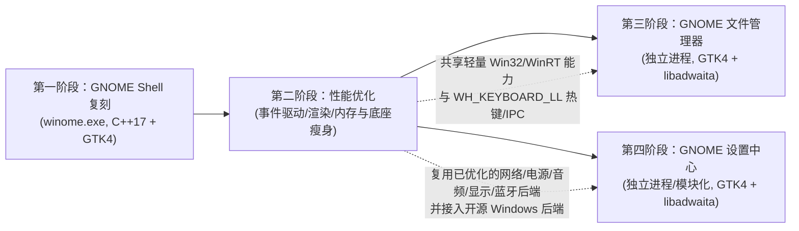

# WINOME 长期规划概览

> 本文为四阶段长期演进总览，串联 **Shell 桌面层（阶段一）→ 性能优化（阶段二）→ 文件管理器（阶段三）→ 系统设置中心（阶段四）** 的目标边界、现有文档索引与关键技术/开源后端选型。本文为独立新增规划文档，未改动现有文档与源码。

---

## 总体路线图

| 阶段 | 核心定位 | UI 真源（`upstream/`） | 底层依赖策略 | 进程与许可证边界 |
|---|---|---|---|---|
| **第一阶段** | 复刻 GNOME Shell 外观并嫁接 Windows 原生桌面能力 | `gnome-shell/`、`Cantarell/` | 单进程原生 Win32 + WinRT 桥接，零注入 | `winome.exe`（`GPL-2.0-only`） |
| **第二阶段** | 消除剩余轮询与启动/渲染冗余，建立多进程复用性能基线 | 性能与渲染基线对照 [architecture.md](architecture.md) | 纯事件驱动替换定时轮询、fontmap/纹理与释放优化、LTO/PGO | 沿用并巩固 `winome.exe`（`GPL-2.0-only`） |
| **第三阶段** | 移植 GNOME Files 体验并彻底避开 Explorer/Shell 卡顿链 | `nautilus/` | `NtQueryDirectoryFile` + 异步 `ReadDirectoryChangesW` + `xdgmime` + Go VFS 借鉴 | 建议独立进程 + IPC（可选 `GPL-3.0-or-later`） |
| **第四阶段** | 移植 GNOME Settings UI 并对接开源 Windows 系统后端 | `gnome-control-center/`（`51.beta`） | 复用 WINOME 现有原生模块 + 按面板对照/调用开源 Windows 项目 | 独立进程或兼容模块集成（规避 `GPL-3.0`/`AGPL-3.0` 直接链接） |

---

## 第一阶段：复刻 GNOME 外观与功能嫁接（Shell 层）

第一阶段核心功能骨架已按既有规划落地，详细实现与约束见现有文档：
- **项目现状与模块清单**：[README.md](../README.md)
- **P0–P5 里程碑记录**：[roadmap.md](roadmap.md)
- **系统架构与原生数据源**：[architecture.md](architecture.md)（`wlanapi.dll`、`PowrProf`、WASAPI、WMI/DDC-CI `dxva2.dll`、`winrt-bridge.cpp`、多版本 Win11 虚拟桌面 COM）
- **视觉还原与 CSS 管线**：[theme-and-ui.md](theme-and-ui.md)（`StEngine`、`gnome-shell-dark.css` + `st-compat` + `convert-st-css.py`、`BoxPointer`、动画缓动）
- **Windows/GTK4 工程硬约束**：[pitfalls.md](pitfalls.md)

**当前阶段重点（功能收口、底座抽离与长期交互补齐）**：
1. **视觉与交互打磨**：持续对照 `upstream/gnome-shell/` 收敛 TopBar、Quick Settings、DateMenu/SMTC 与 Activities Overview 的细节一致性与多屏边缘体验。
2. **后端底座解耦**：将 `WINOME/src/` 中已验证稳定的系统能力（`monitor-manager.cpp`、`system-status.cpp`、`power-modes.cpp`、`wifi-networks.cpp`、`winrt-bridge.cpp`、`notifications.cpp`、`virtual-desktop.cpp`、`app-index.cpp`）整理为可被后续阶段复用的内部模块或 IPC 服务，避免第三、四阶段重复造轮子。
3. **高频交互与扩展闭环（长期演进）**：补齐 GNOME 风格 `Alt+Tab` 窗口切换浮层、键盘分屏/窗口平铺、会话电源倒计时弹窗（`EndSessionDialog`）与 `PrintScreen` 全局截图/录屏 UI；通过无注入 API（如 `DwmSetWindowAttribute`）轻度统一第三方 Win32 窗口暗色标题栏与圆角；预留基于子进程/管道 + JSON 的轻量顶栏微件扩展协议（参考 `upstream/astal`），避免用户小组件拖垮主壳。

---

## 第二阶段：性能优化（Shell 加固与底座轻量化）

> 在把文件管理器与设置中心接入桌面生态前，先完成性能收口与资源瘦身，避免多组件上线后放大空闲功耗、启动延迟或内存占用。

**已有基线**（详见 [architecture.md](architecture.md) 第 7 节）：
- 已落地 `gtk_widget_add_tick_callback` 帧时钟动画、`400ms` z-order 漂移门控、图标/纯透明帧重绘守卫与 OpenGL（`GskGLRenderer` / `ngl`）硬件绘制；
- 当前内存基线：`release` + LTO 构建约 `30MB`，`test` 构建约 `450MB`（主要源于 Pango fontmap 启动枚举全系统约 290 族字体，约 `6s` 后驻留稳定）。

**核心优化方向**：
1. **剩余轮询转事件驱动，压低空闲 CPU 唤醒**：针对 [architecture.md](architecture.md) 中仍采用定时器的路径——左上角热角（`src/hot-corner.cpp` 的 `100ms` 鼠标轮询）、全屏与置顶监视（`src/fullscreen-watcher.cpp` 的 `400ms` 周期）及概览外桌面切换跟随（`400ms` 轮询）——尽可能收敛到 `SetWinEventHook`、`WH_MOUSE_LL` 或桌面事件回调，减少后台空转唤醒。
2. **启动路径、字体枚举与纹理内存治理**：优化 Pango fontmap 启动全量枚举造成的冷启动延迟与开发态高峰值；规范 `app-index.cpp`（96 条上限 `GdkTexture` LRU 缓存）与概览 DWM 实时缩略图生命周期，在概览关闭或切屏后及时回收离屏/不可见纹理与显存占用。
3. **GTK4 / GSK 渲染帧耗时与多高刷屏调优**：针对概览开合、工作区横向滑屏与弹出浮层建立帧时间/掉帧监控基线，定位引发容器重复 relayout 或 GSK 渲染节点失效的热点；在 `release` + LTO 基础上评估 PGO 与按需延迟加载，确保后续接入第三、四阶段组件时不再成倍复制系统监听与缓存开销。
4. **跨版本 ABI 探针与自动化回归体系（长期防退化）**：针对依赖未文档化接口的模块（VD COM、Systray、`IPolicyConfig` 等）建立启动探测与**单项功能熔断降级**机制，防止 Windows 大版本更新导致整壳崩溃；扩充 [WINOME/tests/](../WINOME/tests/)，建设长跑内存泄漏、唤醒统计与多 Windows Build 自动化冒烟/UI 回归基线。

---

## 第三阶段：移植 GNOME 文件管理器（Files / Nautilus）

完整技术调研、本机 MSYS2 UCRT64 依赖核查及已拉取参考仓库索引见专项文档：[file-manager-research.md](file-manager-research.md)。

**核心规划**：
1. **UI 与交互复刻**：引入 UCRT64 已提供的 `libadwaita`（`1.9.3-1`），参考 [upstream/nautilus/](../upstream/nautilus/)（`GPL-3.0-or-later`）的 `GtkGridView`、`GtkColumnView`、路径栏与进度弹窗设计（仅参考 UI 结构与交互逻辑，不照搬 Linux GVfs/D-Bus）。
2. **外科手术式去 Shell 卡顿架构（推荐路线 B）**：
   - 目录枚举直走 `ntdll!NtQueryDirectoryFile` / `FindFirstFileExW(FindExInfoBasic)`，监控走异步 `OVERLAPPED`/`IOCP` 驱动 `ReadDirectoryChangesW`；
   - 大批量传输采用“目录骨架预创建 + 多线程 `CopyFile2`”；仅回收站移入与 UAC 提权写操作按需异步单批触发 `IFileOperation`（或按 `$Recycle.Bin` 二进制 `$I`/`$R` 规范自写）；
   - MIME 与缩略图优先使用 `xdgmime` + 多核限流异步管线，右键主菜单 100% 自绘（第三方扩展按需后台子进程懒加载），严格处理 Junction 环路、OneDrive 云占位符（防触发 Hydration）与 `AppExecLink`。
3. **吸收 Go 家庭存储与 VFS 优秀实践**：参考本地 `upstream/` 已拉取仓库中的 `rclone`（长路径 `\\?\` 与文件锁定退避）、`filebrowser-quantum`（搜索抢占取消与内存/信号量双控缩略图）、`OpenList`（可插拔 VFS 接口与全链路取消）、`libsmb2`/`go-smb2`（非微软 SMB2/3 客户端）、`lf`（监控防抖）。
4. **桌面联动**：复用 [WINOME/src/overview-trigger.cpp](../WINOME/src/overview-trigger.cpp) 的 `WH_KEYBOARD_LL` 钩子接管 `Win+E` 唤醒新文件管理器，避免粗暴篡改注册表 `Folder\shell\open` 导致 `explorer.exe` 递归异常。
5. **轻量预览与伴侣视图闭环（长期配套）**：复用 UCRT64 已有文档/媒体库（`poppler`、`ffmpeg`、`libheif`、`libavif`、`libarchive`），顺势承接**空格快速预览（Sushi 语义）**及轻量看图/PDF/归档查看器，避免在高速文件浏览中一双击就跳回卡顿的系统内置“照片”或 Edge。
6. **形态建议**：建议作为独立可执行文件（如 `winome-files.exe`）通过 Named Pipe / CLI 与 `winome.exe` 协同，便于自由选用 `GPL-3.0-or-later` 并与 `WINOME` 主体保持许可证隔离。

---

## 第四阶段：移植 GNOME 设置 UI（`gnome-control-center`）与开源后端矩阵

### 4.1 UI 起步基础
- 仓库 [upstream/gnome-control-center/](../upstream/gnome-control-center/) 已预置上游 **`51.beta`** 源码，协议为 **`GPL-2.0-or-later`**（`meson.build` 声明 `GPL2+`），基于 **GTK4 + libadwaita**。
- 其面板清单（[shell/cc-panel-loader.c](../upstream/gnome-control-center/shell/cc-panel-loader.c) 及 `panels/` 目录）包含 `22` 个功能面板模块：`applications`、`background`、`bluetooth`、`color`、`display`、`keyboard`、`mouse`、`multitasking`、`network`（含 `wifi`）、`notifications`、`online-accounts`、`power`、`printers`、`privacy`、`search`、`sharing`、`sound`、`system`（含 `about`/`datetime`/`region`/`users` 子页）、`universal-access`、`wacom`、`wellbeing`、`wwan`。
- `WINOME` 目前仅有轻量设置窗体（[WINOME/src/settings-window.cpp](../WINOME/src/settings-window.cpp)），第四阶段将其演进为完整的 GNOME Settings 风格独立应用或分面板模块，替换 Linux 专属后端（D-Bus / NetworkManager / UPower / CUPS / BlueZ）。

### 4.2 开源 Windows 后端项目调研与映射矩阵

目前 Windows 开源生态中**没有单一 C/C++ 项目覆盖 GNOME 设置全部面板**，建议采用**“WINOME 原生模块优先复用 + 按面板对照/集成专用开源项目 + ReactOS/Seelen-UI 底层参考”**的三层策略：

| 目标 GNOME 面板 | 已有可用 / 开源后端项目 | 语言 | 开源协议 | 核心可复用/借鉴能力与接入方式 |
|---|---|---|---|---|
| **第一层：WINOME 现有后端（直接复用扩展）** | `WINOME/src/` 现有模块（`monitor-manager.cpp`、`system-status.cpp`、`power-modes.cpp`、`wifi-networks.cpp`、`winrt-bridge.cpp`、`notifications.cpp`、`virtual-desktop.cpp`） | C++17 | `GPL-2.0-only` | 已实现 Wi-Fi、电源模式、WASAPI 主音量、WMI/DDC-CI 亮度、夜间模式、暗色主题、蓝牙开关/已配对设备、通知/免打扰、虚拟桌面与显示器拓扑基础，应作为首选原生后端 |
| **综合控制面板底层参照** | `reactos/reactos`（`dll/cpl/*`：`desk`、`main`、`mmsys`、`powercfg`、`timedate`、`sysdm`、`inetcpl`、`input`、`ncpa`） | C / C++ | `GPL-2.0-or-later` | 最贴近 WINOME 技术栈的**纯 C/C++ Win32 洁净室实现**，可直接对照其调用 `SetupAPI`、`PowrProf`、显示/时间/键盘/鼠标注册表与系统 API 的细节 |
| **综合系统壳参考（本地已有）** | [upstream/Seelen-UI/](../upstream/Seelen-UI/)（`src/background/windows_api/` 与 `src/background/modules/`） | Rust | `AGPL-3.0-or-later` | 覆盖显示器/亮度、媒体/音频策略（`audio_policy_config.rs`）、蓝牙/Wi-Fi、电源、专注助手、语言、字体等；**受 AGPL 限制严禁抄入源码**，仅作 Win32/WinRT API 选型目录 |
| **综合轻量状态栏参考** | `amnweb/yasb` | Python | `MIT` | 轻量封装 Windows 音量/应用音频会话、蓝牙连接/电量、亮度、电源计划 API 的调用模式参考 |
| **显示与亮度（`display`）** | `MartinGC94/DisplayConfig` `emoacht/Monitorian` / `xanderfrangos/twinkle-tray` `terrymacdonald/DisplayMagician` | C#/PS C#/JS C# | `MIT` `MIT` `GPL-3.0` | `DisplayConfig` 演示 `SetDisplayConfig`/CCD 分辨率、刷新率、缩放与多屏拓扑；`Monitorian`/`twinkle-tray` 补齐外接显示器 DDC/CI 亮度；`DisplayMagician` 参考多屏 Profile 联动 |
| **外观与主题切换（`background`）** | `AutoDarkMode/Windows-Auto-Night-Mode` | C# | `GPL-3.0` | 明暗主题自动切换、壁纸与定时切换的 Windows 注册表/主题通知机制（作规则对照） |
| **声音（`sound`）** | `Belphemur/SoundSwitch` `frgnca/AudioDeviceCmdlets` `File-New-Project/EarTrumpet` | C# C#/PS C# | `GPL-3.0` `MIT` `MIT`*（含排除条款）* | 默认播放/录制端点切换、热插拔事件、Per-App 混音与 WASAPI 路由参考（注意 `EarTrumpet` 含特定法人排除条款，仅作机制理解或改用纯 MIT `AudioDeviceCmdlets`/Win32 `IPolicyConfig` 思路） |
| **蓝牙（`bluetooth`）** | `inthehand/32feet` | C# | `MIT` | 经典蓝牙、BLE 与 OBEX 在 Windows 下的配对、状态查询与协议细节参考，配合扩展 `winrt-bridge.cpp` |
| **色彩管理（`color`）** | `Maassoft/ColorControl` `eoyilmaz/displaycal-py3`（+ `ArgyllCMS`） | C# Python/C | `GPL-3.0` `GPL-3.0-or-later` / `AGPL-3.0` | HDR/ICC 校色配置文件读写参考；若需真硬件校色可作为外部可选工具调用，不内置强 Copyleft 代码 |
| **键鼠 / 多屏 / 数位板（`keyboard` / `mouse` / `wacom`）** | `microsoft/PowerToys` `mgth/LittleBigMouse` `OpenTabletDriver/OpenTabletDriver` | C++/C# C#/Rust C# | `MIT` `GPL-3.0` `LGPL-3.0` | PowerToys Keyboard Manager 提供低级键盘钩子改键参考；`LittleBigMouse` 参考异构 DPI 跨屏鼠标坐标补偿；`OpenTabletDriver` 提供用户态 HID 数位板映射参考 |
| **应用 / 默认程序 / 隐私与网络（`applications` / `privacy` / `network`）** | `Devolutions/UniGetUI` `Raphire/Win11Debloat` / `ChrisTitusTech/winutil` `henrypp/simplewall` | C# PowerShell C | `MIT` `MIT` `GPL-3.0` | `UniGetUI` 提供 WinGet/Scoop/Chocolatey 应用枚举与更新调用；`Win11Debloat`/`winutil` 提供 Windows 隐私与系统开关注册表映射清单；`simplewall` 演示纯 C 调 Windows Filtering Platform (WFP) 规则管理 |

### 4.3 面板优先级与工程合规边界
1. **分批移植与裁剪建议**：
   - **首批核心面板**：`system`（关于/日期时间/区域语言）、`display`、`sound`、`network`/`wifi`、`bluetooth`、`power`、`background`、`multitasking`（承接 WINOME 壳偏好设置）、`notifications`、`keyboard`、`mouse`；
   - **第二批系统面板**：`applications`（应用列表与默认打开）、`privacy`、`universal-access`、`printers`（直调 Win32 Spooler API）；
   - **精简或重构面板**：`search` 改为配置 WINOME 本地检索索引；`online-accounts`、`wwan`、`wellbeing`、`sharing` 视桌面场景按需精简或跳转对应系统页；
   - **长期生态与自愈入口**：依托 `applications` 与 `UniGetUI`/WinGet 思路逐步外延轻量**软件管理/更新中心**与 **GNOME 风格系统监视器**（替代高频打开的任务管理器），并在设置内提供“系统冲突诊断与一键安全还原原生桌面”入口。
2. **协议与技术栈隔离原则**：
   - `WINOME/meson.build` 当前为 `GPL-2.0-only`；`upstream/gnome-control-center` 为 `GPL-2.0-or-later`（兼容 `GPL-2.0-only` 或独立升为 `GPL-3.0-or-later`）。
   - 上表中 **C# / Python / `GPL-3.0` / `AGPL-3.0`** 项目均**不直接静态链接**进 GTK4 C++ 进程：`MIT` 与 `ReactOS`（`GPL-2.0-or-later`）可直接参考其 Win32 API 写法用 C++ 重写；`GPL-3.0` / `AGPL-3.0` 项目仅作黑盒机制研究，或以用户自行安装的外部 CLI 进程形式按需桥接。

---

## 五、前置关键决策与工程补齐项（落地方案前需先定清）

1. **多进程公共底座与发行契约**：第三、四阶段独立进程后，需将现有 `WINOME_ControlWindow` 单向通知演进为双向本机 IPC（如 Named Pipe），统一支撑热键直达目录、Quick Settings 深链接跳转设置面板与 `config.json`/主题变更广播；改造 [WINOME/package.sh](../WINOME/package.sh) 共用同一套 `/ucrt64/bin` GTK4/`libadwaita`/Adwaita 运行时目录，避免多份 DLL 膨胀；明确“普通权限 UI + 按需短生命周期 UAC Helper”提权边界。
2. **第二阶段可量化基准与 CJK 字体方案**：补齐冷启动分阶段计时、ETW/WPR 空闲唤醒率与 `GskGLRenderer` 高刷多屏帧耗时观测脚本；提前解决 [WINOME/src/fonts.cpp](../WINOME/src/fonts.cpp) 现状（顶栏专用 fontconfig 仅含 4 个 `Cantarell` TTF、缺少中文文件名与系统文本所需 CJK 回退，而默认 DirectWrite 启动全扫开销大）的多进程字体回退与缓存共享方案。
3. **`libadwaita` + Win32 最小 PoC 验证**：大规模移植 `nautilus` 与 `gnome-control-center` UI 前，先用最小示例验证 UCRT64 `libadwaita`（`1.9.3-1`）在 Windows 下的 CSD 圆角阴影/Snap Layout 吸附、中文输入法（IME）重命名/搜索候选框兼容性，以及跨软件拖拽（OLE `IDropSource`/`IDropTarget` ↔ GTK4 `GdkDrag`/`GdkDrop`）。
4. **WinRT / 未文档化 COM 技术栈抉择**：评估是继续在 MinGW UCRT64 的 [WINOME/src/winrt-bridge.cpp](../WINOME/src/winrt-bridge.cpp) 中手写 `combase.dll` + vtable 槽位桥接（在完整蓝牙配对、CCD 多屏、WASAPI Per-App 路由下维护成本急剧上升），还是允许用 Rust（`windows-rs`）或 MSVC 编译极薄的纯 C-ABI 后端 DLL 供 GTK4 前端调用。
5. **设置“接管 vs 跳转”清单与破坏性操作沙盒**：针对受 Win11 强保护/高风险项（如 `UserChoice` 默认应用 Hash、系统更新、BitLocker 等）划定“原生读写接管”与“优雅跳转 `ms-settings:*`”边界表；在 [WINOME/tests/](../WINOME/tests/) 扩充隔离目录树测试沙盒，对自写并发 `CopyFile2`、重解析点/OneDrive 占位符与 `$Recycle.Bin` 二进制写入做回归校验。

---

## 六、跨阶段产品化交付与长期克制边界（Non-Goals）

1. **工程化安装、静默自启与更新体系**：在 [WINOME/package.sh](../WINOME/package.sh) 便携压缩包基础上，长期补齐标准安装包（MSI / Inno Setup / WinGet）、基于 Windows 计划任务（Scheduled Task）的**无 UAC 弹窗静默提权开机自启**，以及依托共享运行时 DLL 的增量自我更新器。
2. **长期克制清单（Non-Goals）**：坚持**零全局 DLL 注入**（不劫持反作弊、游戏全屏或强改普通第三方 Win32 软件内部控件）；不以无保障退路的方式强制篡改注册表 `Winlogon\Shell`；确保任意阶段均可秒级无损恢复原生 Windows 桌面。
