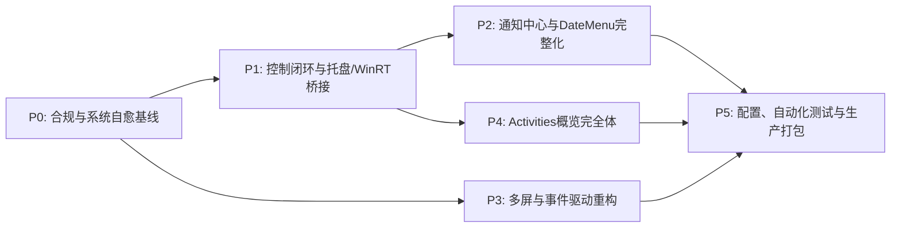

# WINOME 生产级完善开发计划（v0.1 → v1.0）

本计划记录 WINOME 从初期“可运行的单屏 UI 复刻原型（v0.1）”推进至“可日常使用、崩溃安全、多屏可用、功能闭环且可合规打包分发”的 Windows 桌面外壳（Shell）的六阶段演进路线（P0–P5）。

> [!NOTE]
> 第 2 节汇总的 **P0–P5 核心阶段目标已全部完成**（含许可证 `GPL-2.0-only` 合规统一、`--watchdog` / `recovery.dat` / `--restore` 任务栏安全自愈、多屏/事件驱动、Activities 概览与自包含便携打包）。第 1 节与第 3 节完整保留初期审计基线与分阶段设计方案供架构追溯。

---

## 1. 初期原型审计基线与当前解决状态

下表对照记录 `v0.1` 初期源码审计发现的结构性短板及其在 P0–P5 落地后的当前状态：

| 维度 | v0.1 初期原型现状 | 潜在生产风险 | 当前解决状态 |
|------|-------------------|--------------|--------------|
| **系统安全与自愈** | 初期 `main.cpp` 仅在正常 `on_shutdown` 恢复 `SPI_SETWORKAREA` 与调用 `NativeTaskbar::restore()` | 进程异常退出时原生任务栏与工作区残留占用 | **已解决（P0）**：已接入 `--watchdog` 看门狗、`recovery.dat` 快照、异常捕获、`--restore` / `restore-taskbar.bat` 与纯 Win32 崩溃恢复窗 |
| **许可证合规** | 早期原型中 `fonts.h` / `fonts.cpp` 曾标有 `AGPL-3.0-or-later`，与整体 `GPL-2.0-only` 冲突 | 不兼容许可证阻塞二进制公开发行 | **已解决（P0）**：已基于 Fontconfig/Pango API 独立重构并将全仓库源码统一对齐 `GPL-2.0-only` / `MIT` |
| **目录与权限兼容** | 早期字体释放到程序同级目录、日志无上限追加 `%TEMP%\winome.log` | 只读安装目录写失败、日志无限膨胀 | **已解决（P0）**：配置、字体与 `5MB` 轮转日志统一迁至 `%LOCALAPPDATA%\WINOME\`（兼容 CJK 用户名路径） |
| **硬件控制与快速设置** | 早期 `quick-settings.cpp` 开关回调与亮度/电源权限未接通 | 面板控件空转或静态占位 | **已解决（P1）**：音量/静音、WMI/DXVA2 亮度、Wlan 枚举与密码连接、WinRT 蓝牙、深色主题/勿扰/夜间/飞行模式均已闭环 |
| **系统托盘** | 隐藏原生 `Shell_TrayWnd` 后无第三方托盘替代展示 | 常驻软件图标不可见/不可交互 | **已解决（P1）**：`systray.cpp` 混合兼容传统 `ToolbarWindow32` 与 Win11 XAML 托盘并支持右键菜单 |
| **日历与通知中心** | 早期 `calendar.cpp` 仅含月历网格，无通知与媒体控制 | 丢失 Toast 通知与媒体控制入口 | **已解决（P2）**：双栏 DateMenu 集成 SMTC 媒体卡片、Windows 通知列表、勿扰联动与桌面通知横幅 |
| **概览核心能力** | 早期概览搜索未接线，“显示应用”跳转开始菜单，虚拟桌面能力不完整 | 无法搜应用、固定应用或跨桌面拖拽 | **已解决（P4）**：集成实时搜索、宿主分页 `AppGrid`、`start2.bin` 同步、Dash Favorites、跨桌面拖拽与 Win11 22621/24H2+ 兼容 |
| **多显示器与响应模型** | 早期按单屏实现，依赖 `50ms`–`400ms` 轮询与阻塞式鼠标钩子 | 多屏不可用、高唤醒与主线程卡顿风险 | **已解决（P3）**：支持多屏独立面板/DPI、全屏按屏隔离及 WASAPI/Wlan/WinEvent/钩子线程事件驱动 |
| **测试、配置与打包** | 早期无配置、无 i18n、无单测 CI 与独立运行时打包 | 缺乏回归保障且依赖开发者环境 | **已解决（P5）**：`config.json` 热重载、GTK4 设置窗、`i18n.cpp`、`meson test`、GitHub Actions CI 与自包含便携包已落地 |

---

## 2. 阶段规划总览

| 阶段 | 核心目标 | 状态 | 里程碑出口（Milestone Gate） |
|------|----------|------|------------------------------|
| **P0** | 消除发布级法律阻塞与系统桌面卡死/状态残留风险 | 已完成（Phase 1–3） | 许可证彻底对齐 GPL-2.0；看门狗/`--restore`/MiniDump 自愈；单实例与 `%LOCALAPPDATA%\WINOME\` 安全路径就绪 |
| **P1** | 打通常用系统硬件控制与第三方托盘可用性 | 已完成（Phase 4–5） | 快速设置亮度/Wlan 密码连接/蓝牙与音量静音闭环；`systray.cpp` 系统托盘可用；`winrt-bridge.cpp` 落地 |
| **P2** | 补全顶栏中央日期弹出窗与桌面通知体验 | 已完成（Phase 4） | 接通 Windows 通知抓取、勿扰联动、顶部通知横幅与 SMTC 媒体控制卡片；状态实时同步 |
| **P3** | 支持生产级多显示器与低功耗事件驱动底座 | 已完成（Phase 6） | 多屏独立面板/DPI 与会话热响应；`WlanRegisterNotification` 与 WASAPI 事件回调；独立屏全屏隐现 |
| **P4** | 补齐 GNOME 概览核心工作流（搜索、应用网格、桌面管理） | 已完成（Phase 7） | 键盘直搜应用与窗口；分页应用网格；Dash Favorites 持久化与右键菜单/LRU 缓存；跨桌面拖拽、中键关闭与 Win11 22621/24H2+ 兼容 |
| **P5** | 工程化交付、回归保障与终端用户安装包 | 已完成（Phase 3/8） | `config.json` 与 GTK4 设置窗、`i18n.cpp`、`meson test` 单元测试、GitHub Actions CI（`.github/workflows/ci.yml`）与 `WINOME/package.sh` 自包含便携打包 |

> 注：以上 P0–P5 阶段已全部落地并通过自动化测试；后续围绕 UI 深度复刻（内置 GNOME symbolic 图标、`QuickToggleMenu` 居中展开抽屉、WinRT 蓝牙/通知、`FOLDERID_AppsFolder` UWP 应用与 `AppGrid` 三态切换/高清图标）亦已交付（详见 [theme-and-ui.md](theme-and-ui.md#6-视觉对齐与应用网格迭代post-phase-11-汇总) 与 [dev-logs/2026-11-16.md](dev-logs/2026-11-16.md)）。下一周期长期演进方向请参阅 [long-term-plan.md](long-term-plan.md)；下方保留 P0–P5 原型演进阶段详细设计供历史追溯。

---

## 3. 分阶段设计记录（历史演进档案）

---

### P0：合规基线、系统自愈与运行安全性（已完成）

> [!NOTE]
> **已达成**：本阶段全部阻塞项均已落地并验收通过。全仓库源码（含 `fonts.{h,cpp}`）SPDX 已统一对齐为 `GPL-2.0-only` / `MIT` 兼容体系；同时实现了独立 `--watchdog` 看门狗、`recovery.dat` 状态快照、`--restore` / `restore-taskbar.bat` 急救恢复与纯 Win32 崩溃后操作窗口，可安全用于二进制打包与公开分发。

#### P0.1 许可证审计与第三方合规
- **目标**：消除早期遗留的许可证冲突，核查全仓库静态及运行时依赖许可。
- **落实情况**：
  - [fonts.h](../WINOME/src/fonts.h) 与 [fonts.cpp](../WINOME/src/fonts.cpp) 已使用独立 Fontconfig/Pango 实现并统一为 `GPL-2.0-only`；
  - 核对 [easing.cpp](../WINOME/src/easing.cpp)（`GPL-2.0-only`）、[virtual-desktop.cpp](../WINOME/src/virtual-desktop.cpp)（`MIT`）、`st-compat/`（`GPL-2.0-only`，衍生自 LGPL-2.1/GPL-2.0 上游组件并保留原始版权声明）、Cantarell 字体及运行时 GTK4 依赖；
  - 维护 [THIRD-PARTY-NOTICES](../WINOME/THIRD-PARTY-NOTICES)，明确区分上游派生代码与思路致谢。

#### P0.2 崩溃安全自愈与看门狗机制
- **目标**：确保无论进程正常退出、异常崩溃、任务管理器强杀还是系统会话结束，用户的任务栏与工作区始终能还原。
- **落实情况**：
  - **状态快照**：`main.cpp` 在修改 `SPI_SETWORKAREA` 和隐藏任务栏之前，将工作区范围及任务栏 `ABM_GETSTATE` 状态持久化至 `%LOCALAPPDATA%\WINOME\recovery.dat`；
  - **独立轻量看门狗模式**：`winome.exe --watchdog <pid>` 监视主进程句柄；一旦主进程异常退出，看门狗依据快照多次重查还原 `SPI_SETWORKAREA` 与原生任务栏并弹出零 GTK4 依赖的纯 Win32 操作窗口（`crash-dialog.cpp`）；
  - **启动前自检与异常捕获**：主进程启动优先检查并清理遗留脏状态；注册 `SetUnhandledExceptionFilter`、`std::set_terminate` 与 `signal()`（生成 MiniDump 至 `%LOCALAPPDATA%\WINOME\crashes\`）；
  - **独立急救入口**：提供 `winome.exe --restore` 参数并在便携包内随附 `restore-taskbar.bat`，供极端情况下一键还原桌面。

#### P0.3 运行环境隔离、单实例与线程生命周期治理
- **目标**：脱离开发目录写路径假设，消除游离线程与日志膨胀。
- **落实情况**：
  - **单实例控制**：`main.cpp` 通过命名互斥体 `Local\WINOME_Shell_SingleInstance` 防止双开，并支持 `--show-overview` / `--settings` / `--reload` / `--quit` 与平滑重启 `--after-pid`；
  - **可写路径与日志轮转**：字体、配置与日志统一写入 `%LOCALAPPDATA%\WINOME\`（`winome.log` 超过 5MB 自动轮转 `winome.prev.log`，Fontconfig 通过 ASCII 短路径兼容非 ASCII 用户名）；
  - **权限申请与线程回收**：`system-status.cpp` 电源操作前申请 `SE_SHUTDOWN_NAME`；各辅助线程统一纳入生命周期管理，退出时发送停止信号并 `join()`。

- **P0 验收标准（DoD，已通过）**：
  - 全仓库 `SPDX-License-Identifier` 与打包依赖清单 100% 兼容 `GPL-2.0-only`；
  - 强杀 `winome.exe` 后看门狗立即还原原生任务栏与桌面工作区；
  - 在无写权限目录与非 ASCII 用户名环境下运行，配置、字体与日志读写正常工作。

---

### P1：系统控制闭环、WinRT 桥接与系统托盘兼容

#### P1.1 解决 UCRT64 WinRT 工具链瓶颈（WinRT 桥接层，已完成）
- **背景**：[pitfalls.md](pitfalls.md) 已记录 MSYS2 UCRT64 缺少 `winrt/` 头文件，导致蓝牙、通知监听、SMTC 媒体控制、飞行模式长期受阻。
- **最终落地实现（[winrt-bridge.cpp](../WINOME/src/winrt-bridge.cpp)）**：
  - 最终采用**进程内动态加载 `combase.dll` + 裸 COM/WinRT vtable 指针**于专用后台 MTA 工作线程执行，免除了外置辅助进程并保持纯 MSYS2 UCRT64 单工程编译；
  - 覆盖 4 类能力：**无线射频（Bluetooth Radio）控制**、**`UserNotificationListener` 通知读取与清除**（含 Win11 `NotificationVisual::get_Bindings` 漏 `AddRef` 补偿探测）、**SMTC 媒体会话控制**，Wi-Fi 射频由 `wlanapi.dll` 直接控制。

#### P1.2 快速设置 8 个胶囊与滑块全量闭环
- **屏幕亮度**（`system-status.cpp`）：
  - 优先查询笔记本内屏 WMI `WmiMonitorBrightness` / `WmiMonitorBrightnessMethods`（`ROOT\WMI`）；失败或台式外接显示器则走 `dxva2.dll` (`GetPhysicalMonitorsFromHMONITOR` + `GetMonitorBrightness` / `SetMonitorBrightness`)；若均不支持则动态隐藏亮度滑块行。
- **Wi-Fi 完整交互**（`wifi-networks.cpp`、`quick-settings.cpp`）：
  - 扫描与连接迁至后台工作线程（消除 UI 阻塞）；打开二级菜单时触发 `WlanScan` 获取最新 AP；
  - 点击胶囊主体调用 WinRT/Wlan `WlanSetInterface` 真切换无线射频；
  - 点击未保存的加密网络弹出内嵌密码输入行，生成合规 WLAN XML Profile 后调用 `WlanSetProfile` + `WlanConnect`；支持断开当前网络（`winome_wifi_disconnect`）。
- **其余 6 个开关接入**：
  - `Bluetooth`：对接蓝牙射频总开关，二级菜单显示已配对及最近发现设备列表，点击触发连接/断开；
  - `Dark Style`：读写注册表 `HKCU\...\Personalize\AppsUseLightTheme` 与 `SystemUsesLightTheme` 并广播 `WM_SETTINGCHANGE("ImmersiveColorSet")`，开机反向同步初始勾选态；
  - `Do Not Disturb`：维护专注/勿扰状态，与 Windows Focus Assist 状态联动并在开启时抑制托盘/通知气泡弹窗；
  - `Night Light`：读取/切换 Windows 夜间模式注册表状态或调用 Color/Display 控制；
  - `Airplane Mode`：接入 WinRT `Radio` 飞行模式总开关，并反向更新 Wi-Fi / 蓝牙胶囊的锁定/禁用状态；
  - `Keyboard`（键盘背光）：探测设备是否存在背光 HID / WMI 接口；无硬件背光接口的台式机/笔记本遵循 GNOME 行为隐藏该胶囊（不再假性勾选显示）。
- **音频强化**：点击音量滑块左侧喇叭图标可切换静音（`toggle_mute`）；二级菜单或扩展行支持列出全部活跃音频输出设备并切换默认设备。

#### P1.3 Windows 系统托盘（SysTray）兼容层
- **目标**：接管传统 `Shell_NotifyIcon` 常驻应用，使后台应用（微信、输入法、代理等）在隐藏任务栏后仍可操作。
- **技术路径**：
  - 调研并落地独立壳层托盘代理方案（监控系统托盘工具栏按钮 / `TrayNotifyWnd` 句柄映射，或通过合法壳层消息转发将图标尺寸位图、Tooltip 提取到 WINOME 顶栏右侧状态盒之前；点击和右键时将屏幕坐标转发或调度原窗口消息以唤出原生上下文菜单）；
  - 处理动态增删图标、多图标折叠或超长限制，确保不会导致 `explorer.exe` 崩溃。

- **P1 验收标准（DoD）**：
  - 快速设置所有展示的开关与滑块（音量、亮度、Wi-Fi、蓝牙、电源模式、深色模式、勿扰、飞行模式、夜间模式）均能真实读写 Windows 状态并在 2 秒内反射外部修改；
  - 第三方桌面软件（如测试托盘程序、输入法或微信）的托盘图标可显示在顶栏、点击可唤起窗口或弹出右键菜单。

---

### P2：通知中心、日期弹出窗重构与状态一致性

#### P2.1 重构 DateMenu 弹出窗（[calendar.cpp](../WINOME/src/calendar.cpp) / [shell-panel.cpp](../WINOME/src/shell-panel.cpp)）
- 对齐 GNOME `dateMenu.js` 双栏设计：
  - **左栏（消息与媒体区）**：
    - 接入 P1 的 WinRT 通知监听，渲染 `.message-list`（应用图标、标题、正文、时间戳、分组折叠、单条关闭与底栏 **Do Not Disturb** 开关 + **Clear** 清除全部按钮）；
    - 顶部挂载 **MPRIS / SMTC 媒体控制卡片**，显示当前播放曲目、艺术家、专辑封面缩略图以及上一首/播放暂停/下一首按钮。
  - **右栏（日期与日程区）**：
    - 顶部展示本地化今日日期标题（如“星期五 / 2026年11月13日”）；
    - 复用并美化 `winome_calendar_new()`，补充可选周数显示与快速返回“今天”按钮；
    - 下方预留今日日程摘要（对接 Windows Calendar / 本地 ICS 解析扩展接口）与世界时钟。

#### P2.2 实时桌面通知横幅（Toast / `MessageTray`）
- 接管或镜像系统 Toast 通知：在非勿扰模式且非全屏独占场景下，在顶栏正下方展示 GNOME 风格的圆角通知横幅（支持悬停防消失、点击跳转源应用窗口、自动收入 DateMenu 消息列表），在 [win-event-hook.cpp](../WINOME/src/win-event-hook.cpp) 配合抑制重复出现的原生右下角通知弹窗。

#### P2.3 状态栏与二级菜单联动一致性
- `shell-panel.cpp`：网络指示器根据真实连接状态细分无连接、有线网络（`network-wired-symbolic`）、Wi-Fi 4 档信号强度与飞行模式；蓝牙图标仅在蓝牙开启/已连时显隐；时钟与弹出窗内状态变更统一触发刷新。
- `quick-settings.cpp`：`winome_quick_settings_refresh` 全量覆盖 `powermode` 副标题/图标、`wlan` 副标题/连接态与其余各开关勾选状态，避免状态过期。

- **P2 验收标准（DoD）**：
  - 系统内任意软件触发 Windows Toast 通知后，可在 WINOME 顶部横幅与 DateMenu 消息列表中看到记录并点击清除；
  - 媒体播放时（如浏览器视频、Spotify/音乐播放器）在 DateMenu 内可显示信息并控制播放/暂停。

---

### P3：多显示器全面支持与事件驱动低功耗重构

#### P3.1 多显示器（Multi-Monitor）原生支持
- **显示器拓扑管理器（新增 `monitor-manager.{h,cpp}`）**：
  - 使用 `EnumDisplayMonitors` 与 `GetMonitorInfoW` 维护实时显示器列表（主屏标记、物理分辨率、DPI 缩放、工作区）。
- **多屏顶栏与工作区保留**：
  - 每台显示器分配独立工作区预留计算（支持“仅主屏显示顶栏”或“全屏显示顶栏 + 副屏精简版”配置项）；
  - 主副屏各自跟踪 `WM_DPICHANGED`，在缩放比变化或外接显示器插拔（`WM_DISPLAYCHANGE`）时自动重算面板高度、字体缩放及工作区偏移。
- **多屏 Activities 概览（[overview.cpp](../WINOME/src/overview.cpp)）**：
  - 为每个活动显示器创建对应的全屏概览实例与背景暗幕，支持每屏独立读取对应屏窗口与独立壁纸；确保点击副屏窗口或跨屏激活时 z-order、DWM 缩略图与缩放比例完全准确。
- **独立屏全屏抑制与热角**：
  - [fullscreen-watcher.cpp](../WINOME/src/fullscreen-watcher.cpp) 改为按显示器隔离：副屏全屏游戏/视频只隐藏副屏面板，不影响主屏面板与主屏热角操作。

#### P3.2 事件驱动替换高频轮询与输入钩子加固
- **消除高频轮询**：
  - `native-taskbar.cpp`：取消每 `50ms` 遍历 `EnumWindows` 与盲目调用 `SHAppBarMessage`，改为基于 `RegisterWindowMessageW(L"TaskbarCreated")` + `EVENT_OBJECT_CREATE/SHOW` 事件驱动隐藏，辅以极低频兜底校验；
  - `fullscreen-watcher.cpp`：接入 `EVENT_SYSTEM_FOREGROUND` 与 `EVENT_OBJECT_LOCATIONCHANGE`，在前景切换/窗口全屏化时瞬间隐藏或显示面板，降低常规 `400ms` tick 为轻量巡检；
  - `hot-corner.cpp`：支持鼠标仅在接近屏幕顶部区域（如 `WH_MOUSE_LL` 命中顶边 `y <= threshold`）唤醒检测或保留动态节流，静止时零 CPU 唤醒；
  - 系统数据源：使用 WASAPI `IAudioEndpointVolumeCallback` / `IMMNotificationClient`、`WlanRegisterNotification`、`WM_POWERBROADCAST` 订阅系统状态变更，替代 `2s` 全量轮询。
- **低级钩子线程安全解耦**：
  - `shell-panel.cpp` 的 `WH_MOUSE_LL` 回调从 GTK 主线程剥离至独立轻量 Win32 钩子线程，线程内仅维护原子缓存的弹出窗/锚点 `RECT` 快照并快速放行，复杂关闭与 UI 刷新全部经 `g_main_context_invoke` 异步派发，彻底规避 GTK 卡顿导致系统鼠标卡死或钩子超时失效；
  - 锁屏/解锁/RDP（`WTSRegisterSessionNotification`）与壁纸更新（`WM_SETTINGCHANGE`）监听：解锁或切换壁纸后自动刷新 `g_wallpaper`、重申 `SPI_SETWORKAREA` 并刷新已注册的 DWM 状态。

- **P3 验收标准（DoD）**：
  - 双屏/三屏不同 DPI（如 100% + 150%）混合环境下，开关概览、最大化窗口、单屏全屏视频、插拔副屏均无错位、黑边或工作区遮挡；
  - 桌面静置 5 分钟 `winome.exe` 平均 CPU 占用接近 0%，无 50ms 级后台线程持续唤醒。

---

### P4：Activities 概览完全体（搜索、应用网格、Dash 与桌面管理）

#### P4.1 全局搜索系统（`SearchController`）
- **键盘聚焦直通**：在概览激活状态下拦截可打印字符按键（含英文与输入法激活前键入），自动将输入转发并聚焦到 `.search-entry`（同时支持 `Ctrl+F` 聚焦、`Esc` 清空后二次 `Esc` 关闭概览）。
- **多源异步索引引擎（新增 `app-index.{h,cpp}` / `overview-search.{h,cpp}`）**：
  - 扫描系统应用：`%ProgramData%\Microsoft\Windows\Start Menu\Programs`、`%AppData%\...\Start Menu\Programs` 中的 `.lnk`（解析目标、图标与本地化名称），以及 `FOLDERID_AppsFolder`（`IShellItem` 枚举全部 UWP/Store/Win32 安装应用）；
  - 构建统一匹配打分（前缀优先 + 拼音首字母/中文兼容 + 最近使用权重）：实时汇总 **应用结果**、**已打开窗口切换结果**、**内置轻量计算器** 与 **系统设置快捷项**，键盘上下方向键与回车直达启动或切换。

#### P4.2 原生应用网格（`AppDisplay`）与 Dash 持久化
- **应用网格（新增 `app-grid.{h,cpp}`）**：
  - 参照 `appDisplay.js` 实现分页网格（支持滚轮/左右翻页指示点、应用拖拽创建文件夹），将 Dash 末端 9 点“显示应用”按钮改为切换 `WINDOW_PICKER ↔ APP_GRID` 动画过渡（不再打开系统开始菜单）。
- **Dash 完善（[overview-dash.cpp](../WINOME/src/overview-dash.cpp)）**：
  - 引入固定应用列表持久化（区分 Favorites 与仅运行时出现的临时图标 + 分隔线）；
  - 点击未运行的固定应用时通过 `ShellExecuteExW` / `IApplicationActivationManager` 启动对应 Win32/UWP 应用；点击多窗口应用支持激活最近窗口或悬停展开缩略预览；
  - 支持右键菜单（新建窗口、固定/取消固定到 Dash、全部最小化、退出应用）；增加图标纹理 LRU 缓存与异步后台提取，避免 `overview_dash_repopulate` 卡顿打开首帧。

#### P4.3 虚拟桌面全版本兼容与窗口/桌面操作闭环
- **Windows 全版本槽位表与管理操作（[virtual-desktop.cpp](../WINOME/src/virtual-desktop.cpp)）**：
  - 使用 `RtlGetVersion` 解析 OS Build 号，区分 Windows 10（不同 IID 与槽位）及 Windows 11（22621 / 23H2 / 24H2 / 25H2+）并增加启动期只读探针容错；
  - 新增并封装：`move_window_to_desktop(hwnd, index)`、`create_desktop()`、`remove_desktop(index)`。
- **概览拖拽与缩略图交互（[overview.cpp](../WINOME/src/overview.cpp) / [overview-thumbs.cpp](../WINOME/src/overview-thumbs.cpp)）**：
  - 支持在概览内拖拽窗口缩略图到顶部虚拟桌面药丸（高亮落点），松手移动窗口至目标桌面；拖入新建占位区时自动创建新桌面并移入窗口；
  - 支持药丸悬停关闭空桌面或新增工作区按钮；增加窗口卡片中键快速关闭、概览内方向键选窗与快捷键切工作区。

- **P4 验收标准（DoD）**：
  - 概览中可直接打字搜出系统已装软件与打开窗口并回车启动；点击 9 点按钮或双击 Win 键可在软件内切换分页应用网格；
  - 可在 Dash 固定常用软件并在重启 WINOME 后保留；可鼠标拖拽任意窗口移到其他虚拟桌面，在 Win11 22621 / 24H2+ 稳定支持，老版本系统安全降级为单工作区。

---

### P5：配置体系、多语言、自动化 QA 与生产打包发布（已完成）

#### P5.1 配置系统与轻量设置中心
- 强类型配置层（`config.{h,cpp}`）读写 `%LOCALAPPDATA%\WINOME\config.json` 并支持变更监听与热重载：
  - 外观与面板：时钟格式（24h/12h/秒/星期）、顶栏电量百分比开关、主题强调色/明暗切换、字体缩放覆盖、可选窗口外观统一；
  - 行为与交互：热角开关及冷却阈值、Win 键劫持开关、全屏隐藏策略、多屏顶栏策略、概览默认黑名单、会话确认与开发者模式、Dash 固定应用列表。
- 在快速设置面板与设置入口提供原生 GTK4 **WINOME 设置** 窗口，点击即可修改并即时生效。

#### P5.2 标准国际化（i18n）
- 统一由 `i18n.{h,cpp}` 管理多语言界面文案，默认跟随系统区域并支持在设置页切换。

#### P5.3 自动化测试与 CI 体系
- **单元测试与转换校验（`WINOME/tests/`，接入 `meson test`）**：
  - 覆盖 `easing.cpp`、`overview-layout.cpp`、`wifi-networks.cpp`、`config` 持久化、`virtual-desktop` 槽位与缓存、`host-utils` 黑名单、`systray` 筛选、`winrt-bridge`、`overview-trigger` 热键分类、`plugin-host` 及 `convert-st-css.py` 回归用例。
- **GitHub Actions CI**：
  - 在 Windows runner（`msys2/setup-msys2` UCRT64）上自动执行 `test` + `release` 构建、CSS 覆盖率门禁、`check-widget-classes.py`、`meson test` 与便携打包校验。

#### P5.4 自包含便携打包（已落地）与后续安装器规划
- **依赖收集脚本（[WINOME/package.sh](../WINOME/package.sh)）**：
  - 自动化收集 `winome.exe`（LTO Release）、`winome-ctl.exe`、示例插件及所需的 UCRT64 运行时 DLL（GTK4 / GLib / Cairo / Pango / Fontconfig / HarfBuzz / Epoxy 等）、裁剪版 `Adwaita` symbolic 图标主题、`gdk-pixbuf` loaders 缓存、`gschemas.compiled`、许可声明与 `restore-taskbar.bat`，彻底脱离构建机本地 MSYS2/UCRT64 路径依赖。
- **后续可选安装器方向**：
  - 可在现有便携包基础上按需引入 Inno Setup / MSI 安装向导（可选配置开机自启、崩溃还原快捷方式及卸载前安全退出并还原系统任务栏）。

- **P5 验收标准（DoD，便携版已通过）**：
  - 在未安装 MSYS2 的纯净 Windows 11 环境中解压便携包直接运行，核心功能完整可用；
  - GitHub Actions CI 流水线（构建、单测、样式检查与便携包产物闭包验证）全绿通过。

---

## 4. 阶段执行回顾与版本里程碑

1. **先稳后扩原则**：项目按 **P0（合规与系统自愈）→ P1（控制闭环与托盘）→ P2（通知与 DateMenu）→ P3（多屏与事件驱动）→ P4（Activities 概览完全体）→ P5（测试、CI 与便携打包）** 顺序依次收口交付。
2. **关键架构收敛点**：在 P1 阶段放弃了外置 WinRT 辅助进程草案，改用进程内动态 `combase.dll` + 裸 vtable 桥接，既保留纯 UCRT64 工具链体验又消除跨进程通信开销；同步重写 `fonts.{h,cpp}` 完成 `GPL-2.0-only` 合规闭环。
3. **版本演进里程碑**：
   - **v0.1 原型基线**：验证了单屏顶栏、St CSS 转换管线与早期概览框架；
   - **v0.2–v0.8 演进期**：依次完成合规与崩溃自愈（P0）、硬件控制/托盘/通知（P1–P2）、多屏与事件驱动底座（P3）；
   - **当前发布基线**：已完整落地 P0–P5 全部能力、Looking Glass 调试台、进程外插件体系及自包含便携包，后续演进规划参见 [long-term-plan.md](long-term-plan.md)。
