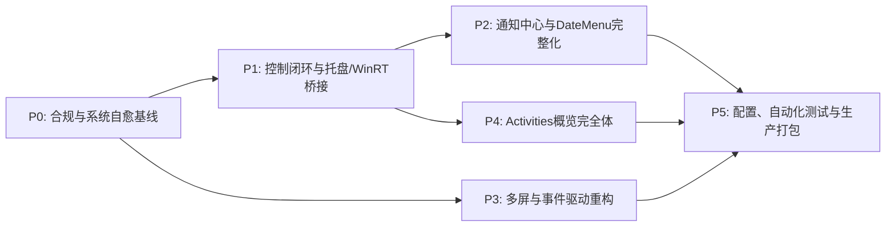

# WINOME 生产级完善开发计划（v0.1 → v1.0）

本计划基于当前仓库实际代码与架构现状制定，目标是将 WINOME 从“可运行的单屏 UI 复刻原型”推进至“可日常主力使用、崩溃安全、多屏可用、功能闭环且可合法打包分发”的 Windows 生产级桌面外壳（Shell）。

---

## 1. 现状与生产就绪差距审计

结合源码核查，当前实现已验证核心视觉与底层通路（DWM 概览动画、Win11 虚拟桌面 COM、St CSS 双管线、部分电源与 Wi-Fi 状态读取），但在生产环境存在以下结构性短板：

| 维度 | 当前现状（源码实证） | 生产环境风险 |
|------|----------------------|--------------|
| **系统安全与自愈** | [main.cpp](../WINOME/src/main.cpp) 仅在正常 `on_shutdown` 恢复 `SPI_SETWORKAREA` 与调用 `NativeTaskbar::restore()` | 进程崩溃、被强杀或注销超实时，原生任务栏永久隐藏且主屏顶部工作区缺失；下次启动无脏状态恢复 |
| **许可证合规** | 项目整体及 [meson.build](../WINOME/meson.build) 声明 `GPL-2.0-only`，但 [fonts.h](../WINOME/src/fonts.h) / [fonts.cpp](../WINOME/src/fonts.cpp) 标注 `AGPL-3.0-or-later` | `GPL-2.0-only` 与 `AGPL-3.0-or-later` 法律不兼容，直接阻塞二进制公开发行 |
| **目录与权限兼容** | `fonts.cpp` 将抽取字体写入程序同级 `winome-fonts/`；`setup_log_file()` 无限追加 `%TEMP%\winome.log` | 安装至 `Program Files` 时普通用户或受限上下文写字体失败；日志长期运行无上限膨胀 |
| **硬件控制与快速设置** | [quick-settings.cpp](../WINOME/src/quick-settings.cpp) 8 个开关胶囊无真实切换回调（`darkmode` 等写死状态）；[system-status.cpp](../WINOME/src/system-status.cpp) 亮度为占位 `0.5`，关机/重启未申请 `SE_SHUTDOWN_NAME` | 面板视觉齐全但多数控制无效或静默失败；无密码连接 Wi-Fi 能力；蓝牙与键盘背光空白 |
| **系统托盘缺失** | 隐藏原生 `Shell_TrayWnd` 后无第三方托盘替代展示 | 输入法、IM、代理、驱动常驻图标完全不可见/不可交互，严重影响日常办公 |
| **日历与通知中心** | [calendar.cpp](../WINOME/src/calendar.cpp) 仅含单一月历网格；无桌面通知横幅与通知列表 | 丢失所有 Windows Toast 通知、媒体控制与勿扰入口，功能缺失严重 |
| **概览核心能力** | [overview.cpp](../WINOME/src/overview.cpp) 搜索栏未接输入与检索；[overview-dash.cpp](../WINOME/src/overview-dash.cpp) 仅列当前运行窗口，点击“显示应用”跳转开始菜单；[virtual-desktop.cpp](../WINOME/src/virtual-desktop.cpp) 仅支持枚举/切屏/固定 | 无法搜索启动应用、无法固定常用软件、无法拖拽窗口跨桌面或增删桌面，仅覆盖 Win11 22621/24H2 部分槽位 |
| **多显示器与响应模型** | 顶栏、概览、热角、全屏监测均按 `g_primary_monitor` 单屏实现；存在 `50ms` 任务栏/`100ms` 热角/`400ms` 全屏/`2s` 状态轮询；`WH_MOUSE_LL` 挂在 GTK 主线程且 `.detach()` 线程无回收 | 多屏副屏无面板与概览；显示/DPI/壁纸变更不重排；主线程卡顿时鼠标钩子易被系统摘除 |
| **测试、配置与打包** | 无持久化配置、无标准 i18n、无单元测试与 CI，产物强依赖本机 MSYS2 UCRT64 环境 | 每次发版与改代码依赖手工实机验证，无法作为独立软件分发给终端用户 |

---

## 2. 阶段规划总览

| 阶段 | 核心目标 | 状态 | 里程碑出口（Milestone Gate） |
|------|----------|------|------------------------------|
| **P0** | 消除发布级法律阻塞与系统桌面卡死/状态残留风险 | 已完成（Phase 1–3） | 许可证彻底对齐 GPL-2.0；看门狗/`--restore`/MiniDump 自愈；单实例与 `%LOCALAPPDATA%\WINOME\` 安全路径就绪 |
| **P1** | 打通常用系统硬件控制与第三方托盘可用性 | 已完成（Phase 4–5） | 快速设置亮度/Wlan 密码连接/蓝牙与音量静音闭环；`systray.cpp` 系统托盘可用；`winrt-bridge.cpp` 落地 |
| **P2** | 补全顶栏中央日期弹出窗与桌面通知体验 | 已完成（Phase 4） | 接通 Windows 通知抓取、勿扰联动、顶部通知横幅与 SMTC 媒体控制卡片；状态实时同步 |
| **P3** | 支持生产级多显示器与低功耗事件驱动底座 | 已完成（Phase 6） | 多屏独立面板/DPI 与会话热响应；`WlanRegisterNotification` 与 WASAPI 事件回调；独立屏全屏隐现 |
| **P4** | 补齐 GNOME 概览核心工作流（搜索、应用网格、桌面管理） | 已完成（Phase 7） | 键盘直搜应用与窗口；分页应用网格；Dash Favorites 持久化与右键菜单/LRU 缓存；跨桌面拖拽、中键关闭与 Win11 22621/24H2+ 兼容 |
| **P5** | 工程化交付、回归保障与终端用户安装包 | 已完成（Phase 3/8） | `config.json` 与 GTK4 设置窗、`i18n.cpp`、`meson test` 单元测试、GitHub Actions CI（`.github/workflows/ci.yml`）与 `WINOME/package.sh` 自包含便携打包 |

> 注：以上各阶段已按工程实施节奏（Phase 1–8）分阶段交付验证并本地提交 Git；下方保留完整技术设计规格说明供维护参考。

---

## 3. 分阶段详细开发计划

---

### P0：合规基线、系统自愈与运行安全性（优先阻塞项）

> [!CAUTION]
> 在 P0 完成前不建议向外部用户分发二进制包：存在 `GPL-2.0-only` 与 `AGPL-3.0-or-later` 冲突，以及程序崩溃后导致系统原生任务栏消失且顶部区域被永久占用的高风险。

#### P0.1 许可证审计与第三方合规
- **目标**：消除 `AGPL-3.0-or-later` 冲突，核查全仓库静态及运行时依赖许可。
- **具体工作**：
  - 审计 [fonts.h](../WINOME/src/fonts.h) 与 [fonts.cpp](../WINOME/src/fonts.cpp)：核对是否纯自主编写或借鉴自 `upstream/Seelen-UI/`；如含外部 AGPL 代码则以纯 Fontconfig/Pango API 重新独立实现并改回 `GPL-2.0-only`。
  - 核对 [easing.cpp](../WINOME/src/easing.cpp)（`GPL-2.0-plus`）、[virtual-desktop.cpp](../WINOME/src/virtual-desktop.cpp)（`MIT`）、`st-compat/`（`LGPL-2.1`）、Cantarell 字体及即将打包的 GTK4 运行时 DLL 许可。
  - 更新 [THIRD-PARTY-NOTICES](../WINOME/THIRD-PARTY-NOTICES) 与构建校验规则（禁止新引入非兼容 SPDX 头）。

#### P0.2 崩溃安全自愈与看门狗机制
- **目标**：确保无论进程正常退出、异常崩溃、任务管理器强杀还是系统会话结束，用户的任务栏与工作区始终能还原。
- **具体工作**：
  - **状态快照**：`main.cpp` 在修改 `SPI_SETWORKAREA` 和隐藏任务栏之前，将主屏/副屏原始 `rcWork` 及各任务栏原 `ABM_GETSTATE` 状态写入 `%LOCALAPPDATA%\WINOME\recovery.json`（含进程 PID 与会话锁）。
  - **独立轻量看门狗模式**：新增 `winome.exe --watchdog <pid>`（无 GTK 依赖的极简 Win32 子路径，内存 < 2MB），`WaitForSingleObject` 监视主进程句柄；一旦主进程非干净退出（未清除恢复标记），看门狗读取快照还原 `SPI_SETWORKAREA` 并恢复任务栏后退出。
  - **启动前自检与异常捕获**：主进程启动最先读取 `recovery.json`，若检测到上一次存在未关闭的残留脏状态，先恢复后再重新抓取真实原始状态；注册 `SetUnhandledExceptionFilter`（导出 MiniDump 到 `%LOCALAPPDATA%\WINOME\crashes\`）与隐藏窗口监听 `WM_QUERYENDSESSION` / `WM_ENDSESSION`。
  - **独立急救命令**：提供 `winome.exe --restore` 参数及独立极简工具 `winome-restore.exe`，供极端情况下手工还原桌面。

#### P0.3 运行环境隔离、单实例与线程生命周期治理
- **目标**：脱离开发目录与管理员特权写路径假设，消除游离线程与日志膨胀。
- **具体工作**：
  - **单实例控制**：`main.cpp` 通过命名互斥体（`Local\WINOME_Shell_SingleInstance`）防止双开冲突；后续实例可向已运行实例传递 `--show-overview` / `--reload` / `--quit` 等控制指令。
  - **可写路径与日志轮转**：`fonts.cpp` 将字体释放目录改为 `%LOCALAPPDATA%\WINOME\fonts`（必要时通过 `GetShortPathNameW` 获取 ASCII 8.3 短路径喂给 `fontconfig`，兼容中文用户名）；日志切换为轮转写入 `%LOCALAPPDATA%\WINOME\logs\winome.log`（超过 5MB 自动轮转为 `.1.log`）。
  - **权限申请与线程回收**：
    - `system-status.cpp` 在 `shutdown_system()` / `restart_system()` 中调用 `OpenProcessToken` + `AdjustTokenPrivileges` 启用 `SE_SHUTDOWN_NAME`，检查返回值并向 UI 返回成功/失败状态；
    - 取消 [win-event-hook.cpp](../WINOME/src/win-event-hook.cpp) 和 [overview-trigger.cpp](../WINOME/src/overview-trigger.cpp) 的 `.detach()`，改为记录 `thread_id`，在 `on_shutdown` 时 `PostThreadMessageW(tid, WM_QUIT, ...)` + `UnhookWindowsHookEx` / `UnhookWinEvent` 并 `join()`；
    - 核实并清理未接入构建调用链的 [desktop-layer.cpp](../WINOME/src/desktop-layer.cpp)（确定正式接入职责或移出构建清单）。

- **P0 验收标准（DoD）**：
  - 全仓库 `SPDX-License-Identifier` 与打包依赖清单 100% 兼容 `GPL-2.0-only`；
  - 用任务管理器强杀 `winome.exe` 后 1 秒内任务栏与桌面工作区自动完整恢复；
  - 将编译产物拷贝至无写权限的只读目录并在含中文用户名路径下运行，字体、日志与重启/关机功能正常工作。

---

### P1：系统控制闭环、WinRT 桥接与系统托盘兼容

#### P1.1 解决 UCRT64 WinRT 工具链瓶颈（WinRT 桥接层）
- **背景**：[pitfalls.md](pitfalls.md) 已记录 MSYS2 UCRT64 缺少 `winrt/` 头文件，导致蓝牙、通知监听、SMTC 媒体控制、飞行模式长期受阻。
- **方案落地（新增 `WINOME/winrt-bridge/` 模块）**：
  - 采用 **C++WinRT（或独立 `winome-winrt-helper.exe` / C ABI DLL）** 解耦：利用 WinSDK/C++WinRT 生成或由轻量宿主进程暴露标准 JSON-over-NamedPipe / C ABI 接口，主工程仍保持 MSYS2 UCRT64 GCC 编译体验，不破坏现有工具链。
  - 首期暴露 4 类能力：**无线射频（Wi-Fi / Bluetooth / Airplane）控制**、**蓝牙设备列表与连接/断开**、**UserNotificationListener 通知读取**、**SMTC 媒体会话控制**。

#### P1.2 快速设置 8 个胶囊与滑块全量闭环
- **屏幕亮度**（`system-status.cpp`）：
  - 优先查询笔记本内屏 WMI `WmiMonitorBrightness` / `WmiMonitorBrightnessMethods`（`ROOT\WMI`）；失败或台式外接显示器则走 `dxva2.dll` (`GetPhysicalMonitorsFromHMONITOR` + `GetMonitorBrightness` / `SetMonitorBrightness`)；若均不支持则动态隐藏亮度滑块行。
- **Wi-Fi 完整交互**（`wifi-networks.cpp`、`quick-settings.cpp`）：
  - 扫描与连接迁至后台工作线程（消除 UI 阻塞）；打开二级菜单时触发 `WlanScan` 获取最新 AP；
  - 点击胶囊主体调用 WinRT/Wlan `WlanSetInterface` 真切换无线射频；
  - 点击未保存的加密网络弹出内嵌密码输入行，生成合规 WLAN XML Profile 后调用 `WlanSetProfile` + `WlanConnect`；支持断开当前网络（`winome_wifi_disconnect`）。
- **其余 6 个开关接入**：
  - `Bluetooth`：对接蓝牙射频总开关，二级菜单显示已配对及最近发现设备列表，点击触发连接/断开；
  - `Dark Style`：读写注册表 `HKCU\...\Personalize\AppsUseLightTheme` 与 `SystemUsesLightTheme` 并广播 `WM_SETTINGCHANGE("ImmersiveColorSet")`，开机反向同步初始勾选态；
  - `Do Not Disturb`：维护专注/勿扰状态，与 Windows Focus Assist 状态联动并在开启时抑制托盘/通知气泡弹窗；
  - `Night Light`：读取/切换 Windows 夜间模式注册表状态或调用 Color/Display 控制；
  - `Airplane Mode`：接入 WinRT `Radio` 飞行模式总开关，并反向更新 Wi-Fi / 蓝牙胶囊的锁定/禁用状态；
  - `Keyboard`（键盘背光）：探测设备是否存在背光 HID / WMI 接口；无硬件背光接口的台式机/笔记本遵循 GNOME 行为隐藏该胶囊（不再假性勾选显示）。
- **音频强化**：点击音量滑块左侧喇叭图标可切换静音（`toggle_mute`）；二级菜单或扩展行支持列出全部活跃音频输出设备并切换默认设备。

#### P1.3 Windows 系统托盘（SysTray）兼容层
- **目标**：接管传统 `Shell_NotifyIcon` 常驻应用，使后台应用（微信、输入法、代理等）在隐藏任务栏后仍可操作。
- **技术路径**：
  - 调研并落地独立壳层托盘代理方案（监控系统托盘工具栏按钮 / `TrayNotifyWnd` 句柄映射，或通过合法壳层消息转发将图标尺寸位图、Tooltip 提取到 WINOME 顶栏右侧状态盒之前；点击和右键时将屏幕坐标转发或调度原窗口消息以唤出原生上下文菜单）；
  - 处理动态增删图标、多图标折叠或超长限制，确保不会导致 `explorer.exe` 崩溃。

- **P1 验收标准（DoD）**：
  - 快速设置所有展示的开关与滑块（音量、亮度、Wi-Fi、蓝牙、电源模式、深色模式、勿扰、飞行模式、夜间模式）均能真实读写 Windows 状态并在 2 秒内反射外部修改；
  - 第三方桌面软件（如测试托盘程序、输入法或微信）的托盘图标可显示在顶栏、点击可唤起窗口或弹出右键菜单。

---

### P2：通知中心、日期弹出窗重构与状态一致性

#### P2.1 重构 DateMenu 弹出窗（[calendar.cpp](../WINOME/src/calendar.cpp) / [shell-panel.cpp](../WINOME/src/shell-panel.cpp)）
- 对齐 GNOME `dateMenu.js` 双栏设计：
  - **左栏（消息与媒体区）**：
    - 接入 P1 的 WinRT 通知监听，渲染 `.message-list`（应用图标、标题、正文、时间戳、分组折叠、单条关闭与底栏 **Do Not Disturb** 开关 + **Clear** 清除全部按钮）；
    - 顶部挂载 **MPRIS / SMTC 媒体控制卡片**，显示当前播放曲目、艺术家、专辑封面缩略图以及上一首/播放暂停/下一首按钮。
  - **右栏（日期与日程区）**：
    - 顶部展示本地化今日日期标题（如“星期五 / 2026年11月13日”）；
    - 复用并美化 `winome_calendar_new()`，补充可选周数显示与快速返回“今天”按钮；
    - 下方预留今日日程摘要（对接 Windows Calendar / 本地 ICS 解析扩展接口）与世界时钟。

#### P2.2 实时桌面通知横幅（Toast / `MessageTray`）
- 接管或镜像系统 Toast 通知：在非勿扰模式且非全屏独占场景下，在顶栏正下方展示 GNOME 风格的圆角通知横幅（支持悬停防消失、点击跳转源应用窗口、自动收入 DateMenu 消息列表），在 [win-event-hook.cpp](../WINOME/src/win-event-hook.cpp) 配合抑制重复出现的原生右下角通知弹窗。

#### P2.3 状态栏与二级菜单联动一致性
- `shell-panel.cpp`：网络指示器根据真实连接状态细分无连接、有线网络（`network-wired-symbolic`）、Wi-Fi 4 档信号强度与飞行模式；蓝牙图标仅在蓝牙开启/已连时显隐；时钟与弹出窗内状态变更统一触发刷新。
- `quick-settings.cpp`：`winome_quick_settings_refresh` 全量覆盖 `powermode` 副标题/图标、`wlan` 副标题/连接态与其余各开关勾选状态，避免状态过期。

- **P2 验收标准（DoD）**：
  - 系统内任意软件触发 Windows Toast 通知后，可在 WINOME 顶部横幅与 DateMenu 消息列表中看到记录并点击清除；
  - 媒体播放时（如浏览器视频、Spotify/音乐播放器）在 DateMenu 内可显示信息并控制播放/暂停。

---

### P3：多显示器全面支持与事件驱动低功耗重构

#### P3.1 多显示器（Multi-Monitor）原生支持
- **显示器拓扑管理器（新增 `monitor-manager.{h,cpp}`）**：
  - 使用 `EnumDisplayMonitors` 与 `GetMonitorInfoW` 维护实时显示器列表（主屏标记、物理分辨率、DPI 缩放、工作区）。
- **多屏顶栏与工作区保留**：
  - 每台显示器分配独立工作区预留计算（支持“仅主屏显示顶栏”或“全屏显示顶栏 + 副屏精简版”配置项）；
  - 主副屏各自跟踪 `WM_DPICHANGED`，在缩放比变化或外接显示器插拔（`WM_DISPLAYCHANGE`）时自动重算面板高度、字体缩放及工作区偏移。
- **多屏 Activities 概览（[overview.cpp](../WINOME/src/overview.cpp)）**：
  - 为每个活动显示器创建对应的全屏概览实例与背景暗幕，支持每屏独立读取对应屏窗口与独立壁纸；确保点击副屏窗口或跨屏激活时 z-order、DWM 缩略图与缩放比例完全准确。
- **独立屏全屏抑制与热角**：
  - [fullscreen-watcher.cpp](../WINOME/src/fullscreen-watcher.cpp) 改为按显示器隔离：副屏全屏游戏/视频只隐藏副屏面板，不影响主屏面板与主屏热角操作。

#### P3.2 事件驱动替换高频轮询与输入钩子加固
- **消除高频轮询**：
  - `native-taskbar.cpp`：取消每 `50ms` 遍历 `EnumWindows` 与盲目调用 `SHAppBarMessage`，改为基于 `RegisterWindowMessageW(L"TaskbarCreated")` + `EVENT_OBJECT_CREATE/SHOW` 事件驱动隐藏，辅以极低频兜底校验；
  - `fullscreen-watcher.cpp`：接入 `EVENT_SYSTEM_FOREGROUND` 与 `EVENT_OBJECT_LOCATIONCHANGE`，在前景切换/窗口全屏化时瞬间隐藏或显示面板，降低常规 `400ms` tick 为轻量巡检；
  - `hot-corner.cpp`：支持鼠标仅在接近屏幕顶部区域（如 `WH_MOUSE_LL` 命中顶边 `y <= threshold`）唤醒检测或保留动态节流，静止时零 CPU 唤醒；
  - 系统数据源：使用 WASAPI `IAudioEndpointVolumeCallback` / `IMMNotificationClient`、`WlanRegisterNotification`、`WM_POWERBROADCAST` 订阅系统状态变更，替代 `2s` 全量轮询。
- **低级钩子线程安全解耦**：
  - `shell-panel.cpp` 的 `WH_MOUSE_LL` 回调从 GTK 主线程剥离至独立轻量 Win32 钩子线程，线程内仅维护原子缓存的弹出窗/锚点 `RECT` 快照并快速放行，复杂关闭与 UI 刷新全部经 `g_main_context_invoke` 异步派发，彻底规避 GTK 卡顿导致系统鼠标卡死或钩子超时失效；
  - 锁屏/解锁/RDP（`WTSRegisterSessionNotification`）与壁纸更新（`WM_SETTINGCHANGE`）监听：解锁或切换壁纸后自动刷新 `g_wallpaper`、重申 `SPI_SETWORKAREA` 并刷新已注册的 DWM 状态。

- **P3 验收标准（DoD）**：
  - 双屏/三屏不同 DPI（如 100% + 150%）混合环境下，开关概览、最大化窗口、单屏全屏视频、插拔副屏均无错位、黑边或工作区遮挡；
  - 桌面静置 5 分钟 `winome.exe` 平均 CPU 占用接近 0%，无 50ms 级后台线程持续唤醒。

---

### P4：Activities 概览完全体（搜索、应用网格、Dash 与桌面管理）

#### P4.1 全局搜索系统（`SearchController`）
- **键盘聚焦直通**：在概览激活状态下拦截可打印字符按键（含英文与输入法激活前键入），自动将输入转发并聚焦到 `.search-entry`（同时支持 `Ctrl+F` 聚焦、`Esc` 清空后二次 `Esc` 关闭概览）。
- **多源异步索引引擎（新增 `app-index.{h,cpp}` / `overview-search.{h,cpp}`）**：
  - 扫描系统应用：`%ProgramData%\Microsoft\Windows\Start Menu\Programs`、`%AppData%\...\Start Menu\Programs` 中的 `.lnk`（解析目标、图标与本地化名称），以及 `FOLDERID_AppsFolder`（`IShellItem` 枚举全部 UWP/Store/Win32 安装应用）；
  - 构建统一匹配打分（前缀优先 + 拼音首字母/中文兼容 + 最近使用权重）：实时汇总 **应用结果**、**已打开窗口切换结果**、**内置轻量计算器** 与 **系统设置快捷项**，键盘上下方向键与回车直达启动或切换。

#### P4.2 原生应用网格（`AppDisplay`）与 Dash 持久化
- **应用网格（新增 `app-grid.{h,cpp}`）**：
  - 参照 `appDisplay.js` 实现分页网格（支持滚轮/左右翻页指示点、应用拖拽创建文件夹），将 Dash 末端 9 点“显示应用”按钮改为切换 `WINDOW_PICKER ↔ APP_GRID` 动画过渡（不再打开系统开始菜单）。
- **Dash 完善（[overview-dash.cpp](../WINOME/src/overview-dash.cpp)）**：
  - 引入固定应用列表持久化（区分 Favorites 与仅运行时出现的临时图标 + 分隔线）；
  - 点击未运行的固定应用时通过 `ShellExecuteExW` / `IApplicationActivationManager` 启动对应 Win32/UWP 应用；点击多窗口应用支持激活最近窗口或悬停展开缩略预览；
  - 支持右键菜单（新建窗口、固定/取消固定到 Dash、全部最小化、退出应用）；增加图标纹理 LRU 缓存与异步后台提取，避免 `overview_dash_repopulate` 卡顿打开首帧。

#### P4.3 虚拟桌面全版本兼容与窗口/桌面操作闭环
- **Windows 全版本槽位表与管理操作（[virtual-desktop.cpp](../WINOME/src/virtual-desktop.cpp)）**：
  - 使用 `RtlGetVersion` 解析 OS Build 号，区分 Windows 10（不同 IID 与槽位）及 Windows 11（22621 / 23H2 / 24H2 / 25H2+）并增加启动期只读探针容错；
  - 新增并封装：`move_window_to_desktop(hwnd, index)`、`create_desktop()`、`remove_desktop(index)`。
- **概览拖拽与缩略图交互（[overview.cpp](../WINOME/src/overview.cpp) / [overview-thumbs.cpp](../WINOME/src/overview-thumbs.cpp)）**：
  - 支持在概览内拖拽窗口缩略图到顶部虚拟桌面药丸（高亮落点），松手移动窗口至目标桌面；拖入新建占位区时自动创建新桌面并移入窗口；
  - 支持药丸悬停关闭空桌面或新增工作区按钮；增加窗口卡片中键快速关闭、概览内方向键选窗与快捷键切工作区。

- **P4 验收标准（DoD）**：
  - 概览中可直接打字搜出系统已装软件与打开窗口并回车启动；点击 9 点按钮可在软件内切换分页应用网格；
  - 可在 Dash 固定常用软件并在重启 WINOME 后保留；可鼠标拖拽任意窗口移到其他虚拟桌面，在 Win10 22H2 与 Win11 22H2–24H2 上均稳定运行。

---

### P5：配置体系、多语言、自动化 QA 与生产打包发布

#### P5.1 配置系统与轻量设置中心
- 设计强类型配置层（`config.{h,cpp}`），读写 `%APPDATA%\WINOME\config.json` 并支持变更监听与热重载：
  - 外观与面板：时钟格式（24h/12h/秒/星期）、顶栏电量百分比开关、主题强调色/明暗切换、字体缩放覆盖；
  - 行为与交互：热角开关及冷却阈值、Win 键劫持开关、全屏隐藏策略、多屏顶栏/概览策略、Dash 固定应用列表；
  - 托盘与快捷键：自定义热键映射开关、托盘过滤规则。
- 在快速设置面板右上角（原系统菜单设置按钮位置）接入原生 GTK4 **WINOME 设置** 窗口，点击即可修改上述选项并即时生效。

#### P5.2 标准国际化（i18n）
- 放弃源码中散落的 `strcmp(get_system_language(), "zh")` 分支，接入标准 `gettext`（或自研轻量 `.po/.mo` 加载表）统一管理所有 UI 文案与复数/日期格式，默认跟随系统区域并允许在配置页切换语言（至少完整支持简体中文、繁体中文与英文）。

#### P5.3 自动化测试与 CI 体系
- **单元测试集（`WINOME/tests/`，接入 `meson test`）**：
  - 覆盖 `easing.cpp` 贝塞尔数值稳定性、`overview-layout.cpp` 窗口布局收敛与不重叠校验、`wifi-networks.cpp` SSID UTF-8/Latin-1 解码边界、`config` 读写容错、`convert-st-css.py` 回归用例。
- **稳定性与句柄泄漏压力测试**：
  - 编写可自动化触发的回归脚本（重复开合概览、弹出窗、二级菜单 200 次以上，统计 `GetGuiResources(GR_GDIOBJECTS / GR_USEROBJECTS)`、DWM 缩略图数量与进程私有工作集，验证零泄漏）。
- **GitHub Actions CI**：
  - 在 Windows runner（`msys2/setup-msys2` UCRT64）上自动执行 `test` + `release` 构建、CSS 覆盖率门禁、`check-widget-classes.py` 与 `meson test`。

#### P5.4 自包含打包、安装与卸载体系
- **依赖收集脚本（`package.sh`）**：
  - 自动化收集 `winome.exe`（LTO Release）、`winome-winrt-helper.exe`、`winome-restore.exe` 及其所需的 UCRT64 运行时 DLL（GTK4 / GLib / Cairo / Pango / Fontconfig / HarfBuzz / Epoxy 等）、裁剪版 `Adwaita` symbolic 图标主题、`gdk-pixbuf` loaders 缓存及 `gschemas.compiled`，彻底脱离本机 `E:\msys64\` 路径依赖。
- **安装器与运维体验**：
  - 使用 Inno Setup / WiX 打包安装包：支持自定义安装路径、可选配置提权计划任务实现无缝开机自启、集成崩溃安全还原快捷方式，以及**干净卸载**（卸载前检测并安全退出运行中进程、强制还原原生任务栏与工作区、清除开机计划任务）。

- **P5 验收标准（DoD）**：
  - 在一台全新的未安装 MSYS2 的 Windows 11 虚拟机/物理机上，通过安装包一键安装运行，所有功能完整可用；
  - GitHub Actions 流水线全绿，内存与 GDI/USER 对象压测无持续上涨。

---

## 4. 推荐执行节奏与优先建议

1. **先稳再扩**：严格按 **P0 → P1 → P3（核心钩子与多屏框架）→ P2 → P4 → P5** 顺序推进，优先把“不弄坏用户桌面 + 不触犯许可协议 + 核心开关真有用”跑通，再铺开大型新 UI（应用网格与多屏重构）。
2. **明确核心决策点**：P1 启动前需先敲定 **WinRT 桥接方案**（推荐“独立轻量 C++WinRT 辅助进程/DLL + 命名管道/C ABI”，以保留当前极简的 MSYS2 UCRT64 构建体验）以及 **托盘兼容路径**，并先确认 `fonts.cpp` 源码来源。
3. **版本切分建议**：
   - 完成 **P0 + P1** 可产出第一个可内测的 **Beta 体验版（v0.2）**；
   - 完成 **P2 + P3** 达到日常可用基准 **RC 版（v0.8）**；
   - 完成 **P4 + P5** 形成完整可公开发布的 **v1.0 生产版本**。
